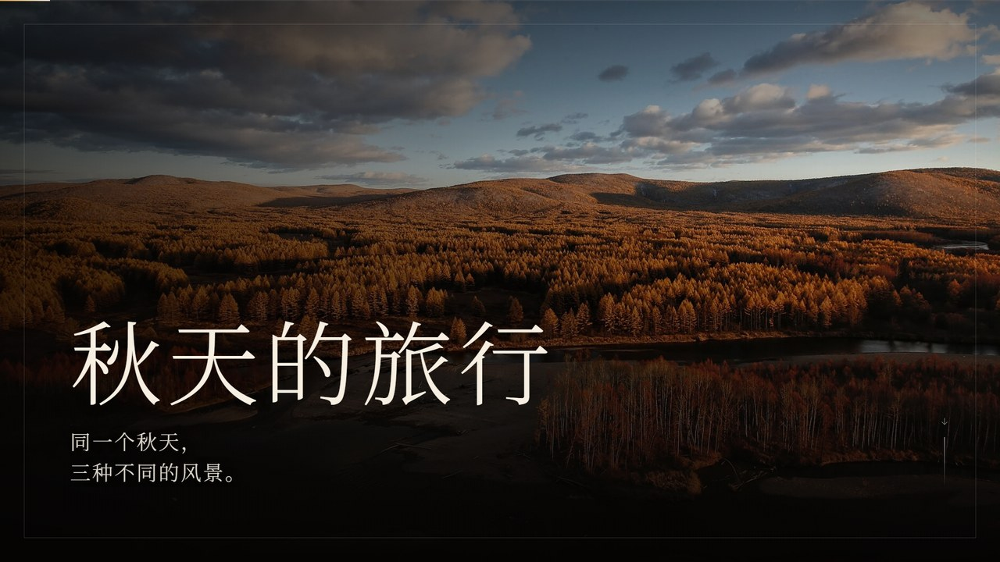
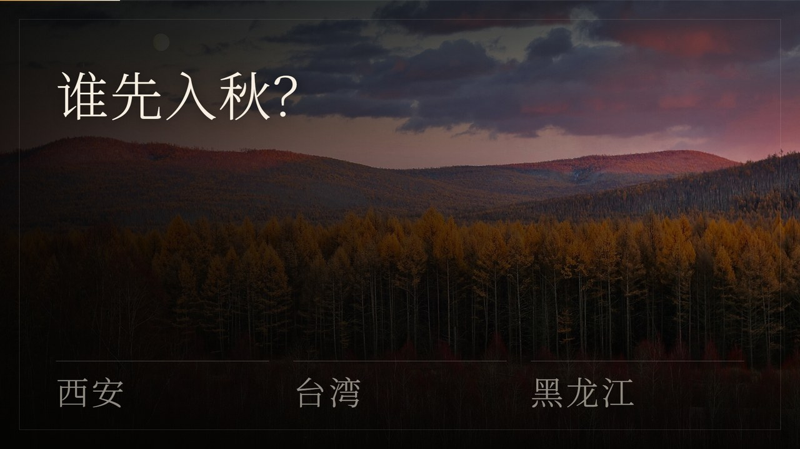
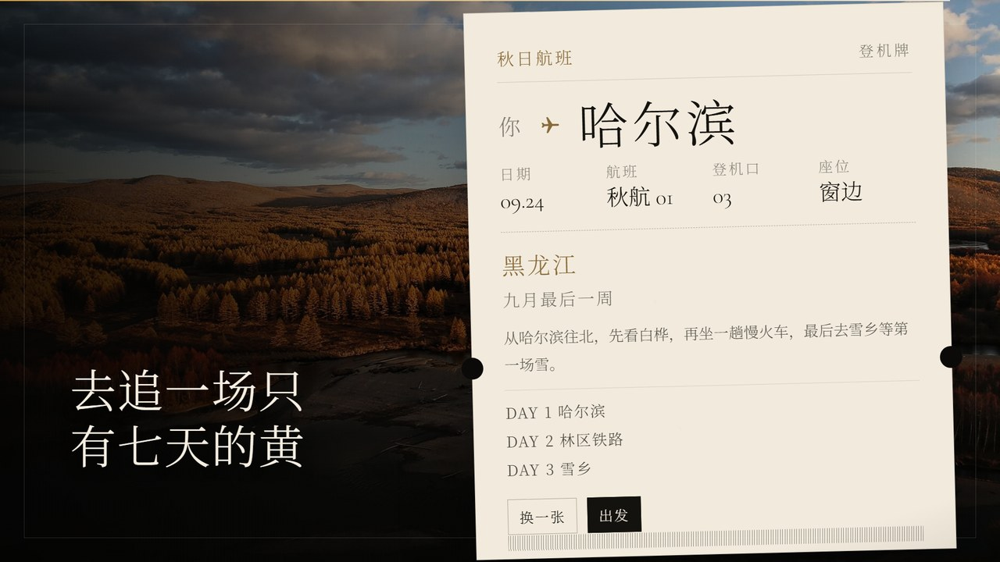
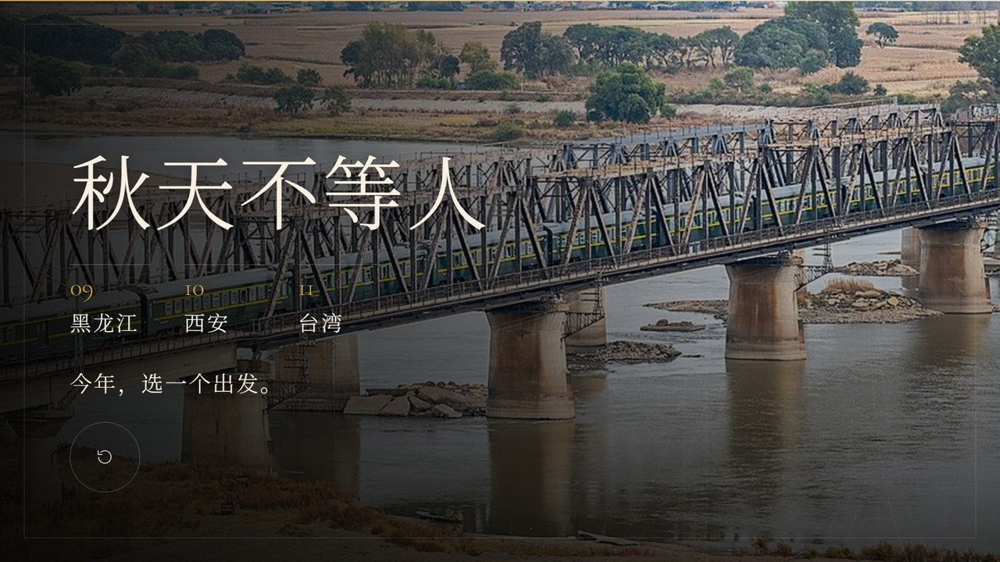

# 秋天的旅行

> 同一个秋天，四种不同的风景。

一部可直接在浏览器里放映的沉浸式摄影演示。16:9 满屏、21 页、无外部依赖、可离线打开。

**黑龙江 → 西安 → 台湾 → 香港。** 从北方林海走到城墙，再到茶山与海港，比较四种秋日节奏。
香港仅补一页“秋是清爽的”；台湾逐页讲稿见 [docs/taiwan-presenter-script.md](docs/taiwan-presenter-script.md)。



## 为什么是这个顺序

| 顺序 | 地方 | 观景参考 |
| --- | --- | --- |
| 01 | 黑龙江 | 北方林区秋色较早，具体叶况看地点与天气 |
| 02 | 西安 | 银杏、柿子与城墙 |
| 03 | 台湾 | 秋日芒花，秋冬落羽松与茶山雾 |
| 04 | 香港 | 山、海与城市之间的清爽秋日 |

月份是景观参考，不是严格的气象入秋日期，也不是四地连续出游路线。资料与图片使用边界见 [内容来源](docs/content-sources.md)。



## 观众互动

这不是只用来“点下一页”的网页。现场可以这样用：

| 页 | 互动 | 现场玩法 |
| --- | --- | --- |
| 03 谁先入秋？ | 猜顺序小游戏 | 让观众举手选，再点选项；答对后出现时间线，并解释“为什么黑龙江先入秋”：纬度高、纬度、海拔与天气共同影响 |
| 07 秋天结束 | 初雪对比 + 自动入冬 | 请观众拖中缝；也可点“看它入冬”，用 5 秒把秋天慢慢推到第一场雪，雪粒和冷色一起出现 |
| 08 黑龙江冷知识 | 问答 | “追白桦秋色，最该留意什么？” 观众喊答案，再点选项揭晓 |
| 12 西安冷知识 | 问答 | “西安城墙有多高？” |
| 16 把雾推开 | 擦雾 | 请观众用鼠标/手指把雾擦开，擦到哪句出现哪句 |
| 17 台湾冷知识 | 问答 | “落羽松的秋冬色彩，何时值得留意？” |
| 19 秋假去哪 | 现场投票 | 问大家“秋假最想去哪”，点一个地方，直接进入它的秋日机票 |
| 20 秋日机票 | 分支机票 | 每个地方一张不同的登机牌：换图、换航线、换三天路线；可“换一张”或“出发” |

三题走完、投票之后，点中的地方会展开一张只属于它的**登机牌**：



最后把四个日期并排放在出发板上：



## 打开方式

直接双击 `index.html`，推荐 **Chrome / Edge**。

- 无需服务器，无需联网。
- `F` 全屏，`G` 目录，`?` 操作与图片授权。
- 所有图片、字体、脚本都在本目录内。

## 键盘

| 按键 | 动作 |
| --- | --- |
| `→` `↓` `Space` `PageDown` | 下一页 |
| `←` `↑` `PageUp` | 上一页 |
| `Home` / `End` | 第一页 / 最后一页 |
| `1` `2` `3` `4` | 在猜顺序、问答、投票页选择 |
| `Enter` | 在雾页一次推开 |
| `F` / `G` / `R` / `?` | 全屏 / 目录 / 重新开始 / 帮助 |
| `Esc` | 关闭浮层 |

鼠标滚轮、触屏左右滑动也能翻页。底部圆点按章节跳转。

## 设计说明

- **没有小字**：没有页码、图片说明、角落小标题、时间标签、口头提示、制作信息。
- 只保留：大标题/引文、正文、大字号选项与回应、章节编号与地名、场景名、纯图标控件、顶部细进度条、章节圆点。
- 投票页标题改为“秋假，你最想去哪玩？”，不再放“举手，再点一个”的小字提示。
- 问答的“为什么”写得更长：不只报答案，还解释纬度、日照、冷空气、城墙尺寸、落羽松变红条件。
- **图片不再跟着鼠标走**：去掉了全屏视差和持续缩放，图片只在入场时做一次 clip-path 揭示；镜头是静的，人才会看进去。
- 每页的入场方式不同：fade / push / wipe / circle / curtain / zoom，章节页有一次性色幕。
- 固定 16:9 舞台；桌面、投影、手机竖屏分别排版。

### 风景重点

每章正文先给“这一带有什么”，三张内容页再各给一个场景牌：

- 黑龙江：白桦秋色示意、松花江铁路意象、林间初雪示意
- 西安：西安城墙 · 银杏、老院子 · 柿子
- 香港：维多利亚港日落（单页）
- 台湾：阳明山 · 芒花、落羽松气根示意、台湾茶山雾

最佳时间写在每章正文里，页面上不再放“时间/标签/提示”这类小字。

## 文件结构

```
index.html                 演示入口
css/style.css              版式、转场、猜顺序/问答、控件、响应式
js/app.js                  渲染与交互引擎（原生 JS）
js/content.js              21 页文案、图片映射、授权
assets/images/             15 张可用图片（webp + jpg 回退）
assets/images/credits.json 图片授权原始记录
type/                      Cormorant Garamond / Manrope / Noto Serif SC 子集
preview/                   预览图
```

## 修改内容

- 改文案：编辑 `js/content.js` 的 `slides`。
- 换图：把图放进 `assets/images/`，保持同名，或改 `js/content.js` 的路径。
- 改版式：`css/style.css` 按 `slide--cover`、`slide--chapter`、`slide--quiz` 等页面类型分块。
- 新增问答：复制 `quiz` 类型的 slide，改 `question / options / correct / explain / tag`。
- 新增场景牌：在 slide 里加 `scene: { place, time }`。

## 图片授权

15 张图片来自 Wikimedia Commons，授权以 CC BY / CC BY-SA / CC0 / Public Domain 为主。
作者、授权和来源链接在演示内 **`?` → 图片授权** 中列出，也可查看 `assets/images/credits.json`。

## 原版本验证记录

下列为原仓库已有的验证记录；本次变更检查见 Pull Request。

- 1920 × 1080（投影 / 桌面）
- 1440 × 900
- 390 × 844（手机竖屏）
- Chrome 无头环境渲染；猜顺序、三题问答、擦雾、初雪拉杆与自动入冬、投票、四张秋日机票、目录/帮助/授权、全屏与键盘导航。

---

秋天的旅行 · 2026
